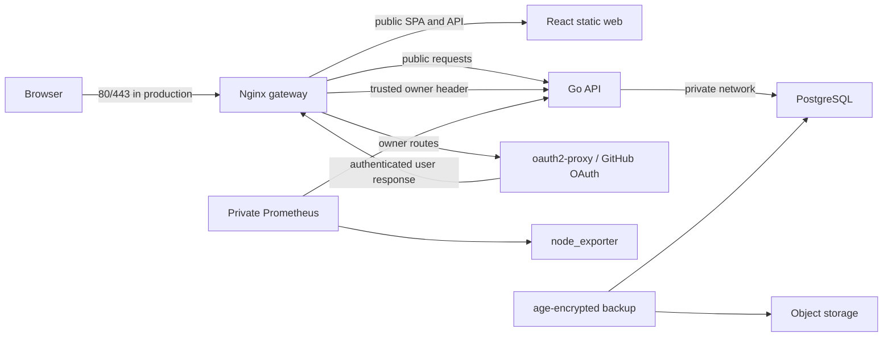

# Portfolio case study

<!-- cspell:words handoff httpapi inspectable opencontainers socketless sqlc unwaived -->

## Outcome

Alright, Mate? demonstrates a small product through its complete engineering path: specification, generated contracts, React UI, Go API, PostgreSQL persistence, container gateway, infrastructure as code, immutable delivery, observability and recovery. Its deliberate constraint is one trusted owner. That keeps the product understandable enough to explain in an interview without disguising operational work behind a platform.

All evidence in this document is local unless a row explicitly says otherwise. No live URL, AWS resource, GitHub OAuth application, GHCR package or production backup is claimed.

Two original completion criteria remain outstanding rather than being rewritten as successes: the owner has not approved or published the twelve content candidates, and the reduced Prometheus/node_exporter monitoring boundary still needs owner approval because Grafana and cAdvisor are deferred on security grounds.

## Architecture and trust boundaries

The runtime path is `Browser → Nginx → oauth2-proxy for owner routes → Go API → PostgreSQL`.

The boundaries are intentional:

- Only Nginx publishes host ports. React, Go, PostgreSQL, oauth2-proxy and monitoring listeners stay on private Compose networks.
- Nginx removes caller-supplied owner, token and forwarding headers. Production owner identity comes only from the oauth2-proxy authentication response and is checked again by the API.
- Public routes never expose review state. Draft and archived records behave as absent.
- CI does not imitate GitHub OAuth. Its separate gateway configuration injects one fixed owner after stripping external identity headers; a real OAuth smoke test remains production work.
- Metrics are private operational interfaces, not product APIs. Prometheus scrapes the API and node_exporter without a Docker socket. Grafana and cAdvisor are deferred because the reviewed official images still contained unwaived HIGH findings.
- Backups are PostgreSQL 18 custom-format dumps encrypted with `age`. A completion marker is published last, and restoration uses a disposable database before an operator may consider live recovery.

## Specification-driven trace

Every vertical slice starts with a Prompt Contract, interface changes and acceptance examples. Generated OpenAPI types prevent the Go server and TypeScript client from acquiring hand-maintained duplicate contracts.

| Journey | Specifications | Automated proof | Implementation boundary |
| --- | --- | --- | --- |
| Public browse | `docs/specs/000-product.md`, `docs/specs/001-public-expressions.md`, `specs/openapi.yaml` | `tests/e2e/tests/public.spec.ts`, `apps/api/internal/httpapi/public_test.go` | `apps/web/src/routes/ExpressionsPage.tsx`, `apps/web/src/routes/ExpressionDetailPage.tsx`, `apps/api/internal/application/expressions.go` |
| Owner CRUD | `docs/specs/002-owner-admin.md`, `docs/adr/0003-gateway-auth.md`, `specs/openapi.yaml` | `tests/e2e/tests/owner.spec.ts`, `apps/api/internal/httpapi/admin_test.go`, `tests/e2e/tests/security-and-routing.spec.ts` | `apps/web/src/routes/AdminPage.tsx`, `apps/api/internal/application/expressions.go`, `deploy/nginx/production.conf.template` |
| Review scheduling | `docs/specs/003-review.md`, `docs/specs/data-model.md`, `specs/openapi.yaml` | `apps/api/internal/review/schedule_test.go`, `apps/api/internal/application/reviews_integration_test.go`, `tests/e2e/tests/review.spec.ts` | `apps/api/internal/review/schedule.go`, `apps/api/internal/application/reviews.go`, `apps/web/src/routes/ReviewPage.tsx` |
| Operations | `docs/specs/004-operations.md`, `docs/adr/0001-vm-first.md` | `tests/runtime/docker-runtime.test.mjs`, `infra/tests/test_infra_contract.py`, `tests/ops/test_ops_contracts.py`, `tests/ops/run_local_restore_drill.py` | `compose.production.yaml`, `infra/`, `ops/`, `scripts/delivery/` |

The review state machine is deliberately small: `again` resets to one day; successive `good` ratings advance 1 → 3 → 7 → 14 → 30 days and remain at 30. Instants are UTC, the duplicate-review boundary is `Asia/Seoul`, and a second event for the same expression and Korean date returns HTTP 409. All API errors use RFC 9457 Problem Details.

The working sequence used for each slice was:

1. approve the feature specification;
2. amend OpenAPI and the data contract;
3. persist a failing behavioural test;
4. implement the smallest passing change;
5. run automated verification;
6. ask a separate AI reviewer to look for specification, security and scope defects;
7. accept the change only after human-readable evidence was recorded.

## AI collaboration without runtime AI

AI accelerated drafting, edge-case discovery, test design, implementation and review, but it is not part of the running product. Context was separated between spec drafter, test designer, implementer, adversarial reviewer, British English tutor and operations reviewer. The implementer received approved specifications and tests; reviewers inspected the resulting boundary rather than endorsing their own proposal.

Important prompts, adopted and rejected proposals, human checks and review corrections are summarised in `docs/ai/decision-log.md`. Raw transcripts are intentionally absent. Language candidates also remain outside product seed data until the owner understands the phrase, validates the cited source and approves the original example.

This process found material defects before handoff: combined search and tag semantics, sparse optional-field clearing, trusted-header isolation, mutable image references, retry-contaminated E2E data, misleading UFW comments, backup cleanup reporting and narrow-screen overflow. AI was useful because each claim still had to survive an executable gate or a named human decision.

## Local acceptance evidence

| Area | Local evidence | External boundary |
| --- | --- | --- |
| Product | Real Nginx/React/Go/PostgreSQL Playwright suite: 6/6 journeys, including public browse, owner lifecycle, review/progress, duplicate HTTP 409, route security and responsive overflow | Production GitHub OAuth smoke is pending |
| Responsive UI | In-app browser at 1440×900 and 320×800: Home, Browse, Admin and Review have page overflow delta 0; Review table scroll is contained at client width 283 and content width 544; no console warning/error | No production browser or device claim |
| Frontend | 36/36 unit/component tests, type checking, ESLint, cspell en-GB and production build passed after the responsive fix | CDN or production cache behaviour is pending |
| Backend | Table-driven scheduling, HTTP and real-PostgreSQL integration tests; Go vet/build and generated OpenAPI/sqlc drift checks | Production database performance is not measured |
| Runtime | Pinned container builds, health/readiness, public/owner header boundaries and TLS renewal configuration tested in disposable Compose projects | Real certificate issuance is pending |
| Infrastructure | OpenTofu format/init-without-backend/validate and dual-platform lock verification; Ansible syntax, lint and safe policy convergence twice | No AWS plan/apply or real Ubuntu host convergence is claimed |
| Delivery | Workflow policy, actionlint, ShellCheck, scan-gated eligibility-manifest resolution, exact API, migration, web and backup-tools digests, a forced-command SSH boundary, and idempotent delivery operation recovery tested locally | No Actions run, GHCR push, SSH deployment or production rollback is claimed |
| Recovery | A synthetic PostgreSQL 18 database was dumped, age-encrypted, published to local Garage through env-only rclone S3 configuration, restored to disposable PostgreSQL 18 and checked for exact 1/1/1/1 migration/migration-count/expression/review-event values; rclone reported both final publications as server-side copies, and injected cleanup and metadata mismatch failures were rejected | No real object-store data, elapsed lifecycle behaviour or live restoration is claimed |

The E2E harness gives every attempt a new Compose project and PostgreSQL volume, resets its fixture on retries, and audits cleanup. The 320-pixel regression also proves that the wide progress table may overflow only inside its labelled `.table-scroll` container, not across the page.

### Security gate status

Task 5C's bounded security evidence is green with an empty exception set. A single fresh-cache Trivy 0.73 aggregate completed in about 148 seconds: all six declared dependency roots, the workspace secret scan, the `infra/`, `ops/`, API and web configuration scans, and all seven exact public runtime images passed with zero HIGH or CRITICAL findings. The `.Codex` session-state directory was excluded only after executable contracts proved that it is gitignored, contains no tracked release file or declared dependency root, and that application, infrastructure, operations, specification and documentation sources remain covered; `.superpowers` remains in scope. Four revision-labelled first-party candidates were also exported independently and passed socketless focused scans: API `sha256:d9a38e992bfec44c2fdf33cd79296328b901b3ff7d6461254865fc3743880476`, migration `sha256:4c2bfc4d5702418c6215511b83c3af88c55a6a90dffac66af2e515a9091412f3`, web `sha256:b253c8f725f275c376d5c252b2db045e9657f2f97a2bb2a573d0d29f7c66f644` and backup tools `sha256:b2fb9fe2f2d77cc8832fe94690266716f55da76ed3db094b391bd779ef73fffe`. This is local pre-release evidence, not a claim that GitHub Actions, GHCR or production deployment has run.

## Security decisions

- Application and toolchain container bases are digest-pinned; production application releases use digest references plus matching `org.opencontainers.image.revision` labels.
- Protected-main publication writes the commit-bound eligibility manifest only after the three application images and backup-tools auxiliary pass scanning. Deploy and rollback use the marker's exact API, migration, web and backup-tools digests; each idempotent operation reconciles ambiguous SSH results against remote state.
- The Lightsail firewall and UFW expose only 80/443 and approved management CIDRs. World-open or malformed SSH input is rejected.
- Deployment is designed to use strict SSH host keys, an immutable SHA, a pre-deployment encrypted backup and bounded readiness/public smoke checks. Required reviewers for the GitHub `production` Environment are an external control and remain pending configuration.
- Ordinary application rollback never attempts a database rollback. Migrations must be backwards compatible; restoration is a separate operator procedure.
- Trivy waivers are structured, owned, path/control-specific and limited to 30 days. Secret-file exceptions are forbidden.
- Secrets, private endpoints and real credentials are absent from the repository; checked-in environment files are examples only.

## Cost assumptions

The planning baseline is a Lightsail 2 GB Linux instance at about USD 12 per month, metered S3 storage and request usage, plus an initial KMS key-material charge of about USD 1 per month. Annual KMS rotation can raise that fixed key-material component to about USD 2 and then USD 3, while request, transfer, tax, exchange-rate and domain costs remain separate. Budget alerts are defined at USD 12 and USD 15. These are assumptions rather than incurred costs because no AWS apply occurred; every price must be rechecked against [AWS Lightsail pricing](https://aws.amazon.com/lightsail/pricing/) and the applicable AWS S3/KMS pricing immediately before approval.

## Trade-offs

- **One VM over Kubernetes:** easier to reproduce and operate within six weeks, but no high availability or scheduler-led recovery.
- **Gateway-owned OAuth over application accounts:** a smaller attack and data surface, but the product remains intentionally single-owner and the gateway is security-critical.
- **PostgreSQL logical backup over managed HA:** portable and inexpensive, but recovery is operator-led and has a measurable interruption window.
- **Docker Compose over an orchestrator:** transparent networking and release files, but host capacity and rolling deployment are limited.
- **Two-button review over a richer algorithm:** deterministic tests and an explainable user model, but no difficulty grading or personalised optimisation.
- **No runtime LLM:** no language data leakage, variable cost or generated-content risk, but correction remains a human editorial task.
- **Prometheus without Grafana or cAdvisor:** request, host and backup signals remain inspectable through a private Prometheus UI/API, but dashboards and per-container resource panels are deferred until reviewed upstream images pass the zero-unwaived-finding gate.

## Post-MVP backlog

Kubernetes is a separate SDD cycle, not an unfinished MVP dependency. The proposed learning order is:

1. reproduce the current contract with `kind`;
2. package it as a reviewed Helm chart;
3. deploy to k3s or a managed Kubernetes service after a cost/operations ADR;
4. add Argo CD only after immutable delivery, secret ownership, migration and rollback semantics are preserved.

Multi-user accounts, pronunciation work, social features and runtime AI also require their own product specifications rather than opportunistic additions to this repository.
